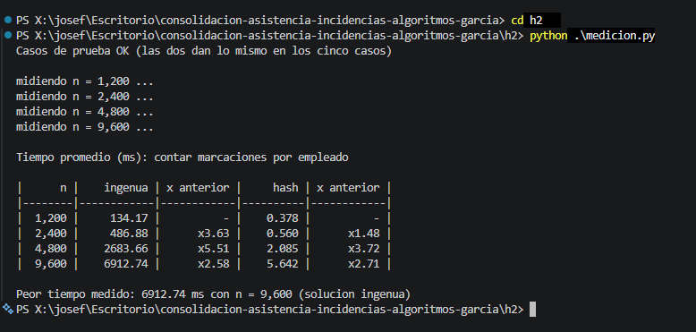

# Medición: estructura ingenua contra adecuada

Proceso: consolidación diaria de asistencia, permisos y vacaciones (H1).

## Experimento

**Problema (el mismo para las dos):** contar cuántas marcaciones tiene cada empleado. Es lo que hoy hace CONTAR.SI.CONJUNTO en mi Excel y es de donde sale el O(n²) de mi H1.

**Ingenua: lista.** Por cada marcación recorre toda la lista contando las que tienen el mismo código. Son n marcaciones por n recorridos, O(n²).

**Adecuada: tabla hash.** Un diccionario con un contador por código de empleado, en una sola pasada. Cada acceso cuesta O(1) en promedio, en total O(n). La elegí porque lo que más hago es buscar y contar por clave exacta (ver `inventario.md`).

**Datos:** reporte simulado sin ordenar, con códigos de empleado del 9001 al 9300 al azar y semilla fija, como en `c6`. Antes de medir se comprueba que las dos dan el mismo resultado.

**Tamaños:** 1.200, 2.400, 4.800 y 9.600 registros. El primero es un día de marcaciones (300 empleados × 4) y cada tamaño es el doble del anterior. No llego a un mes completo (26.400) porque la ingenua tardaría demasiado.

**Protocolo:** 1 corrida de calentamiento que no se cuenta, 3 corridas medidas y promedio. Lenguaje: Python 3.9, ejecutado desde la terminal en una laptop.

## Resultados

Tiempo promedio en milisegundos.

| n     | ingenua (ms) | x anterior | hash (ms) | x anterior |
|-------|--------------|------------|-----------|------------|
| 1,200 | 134.17       | -          | 0.378     | -          |
| 2,400 | 486.88       | x3.63      | 0.560     | x1.48      |
| 4,800 | 2683.66      | x5.51      | 2.085     | x3.72      |
| 9,600 | 6912.74      | x2.58      | 5.642     | x2.71      |

## Conclusión

- La ingenua es O(n²) y se nota en la tabla: al duplicar n tarda más o menos x4, porque cada marcación se compara contra todas las demás (dio x3.63, x5.51 y x2.58). De 1.200 a 9.600 datos, que son 8 veces más datos, tardó 51 veces más, bastante cerca de las 64 veces (8 × 8) que se esperan de un O(n²). Lo que hoy en mi Excel pasa con CONTAR.SI.CONJUNTO es justo esto.
- El hash es O(n): al duplicar n debería tardar x2, porque solo pasa una vez por la lista y cada acceso al diccionario cuesta O(1) en promedio, y dio entre x1.48 y x3.72. Lo más importante es que la diferencia entre las dos crece con n: con 1.200 datos la ingenua es unas 355 veces más lenta que el hash y con 9.600 datos ya es unas 1.225 veces más lenta, que es lo que se espera cuando se compara O(n²) contra O(n).
- Hay ruido, sobre todo en el x5.51 de la ingenua y en los ratios del hash, que tarda menos de 6 ms en todos los tamaños. Medí en una laptop, donde las tareas de fondo y la temperatura del equipo pueden mover los tiempos, y cuando un tiempo es tan chico cualquier pequeña variación cambia mucho el ratio. Por eso me fijo más en la tendencia general (x51 contra x15 en total) que en cada ratio por separado.
- El peor tiempo fue 6912.74 ms con n = 9,600 (la ingenua), contra 5.64 ms del hash para los mismos datos. Para mi caso, un día son 1.200 registros y la ingenua tarda 134 ms, algo que todavía se soporta, pero el costo se dispara cuando los datos crecen. Proyección, no medida: con el peor mes simulado de `c6` (37.200 registros) la ingenua tardaría más de 1 minuto y medio y el hash unos 22 ms. Por eso la tabla hash es la estructura adecuada para mi proceso.