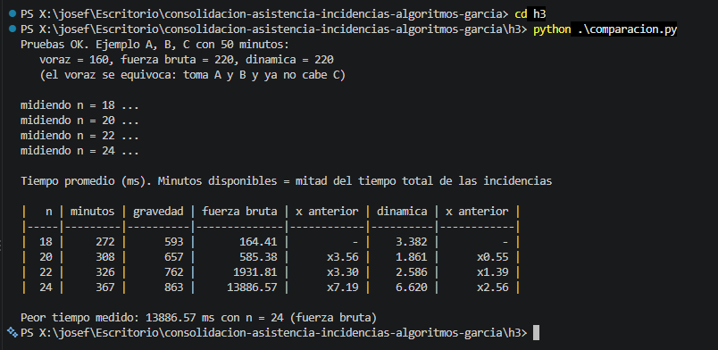

# Comparación medida: fuerza bruta contra programación dinámica

**CASO ANALÓGICO.** Mi proceso real (consolidar asistencia) no es un problema de optimización, como explico en `estrategia.md`. Por eso uso un problema análogo cercano a mi tema: elegir qué incidencias revisar con tiempo limitado. No es algo que mi proceso haga hoy.

## El problema análogo

Cada incidencia tiene un tiempo de revisión (minutos) y una gravedad. Se busca la mayor gravedad total sin pasar del tiempo disponible. En la medición el tiempo disponible es la mitad del tiempo total de todas las incidencias.

## Las estrategias

**Fuerza bruta:** prueba todas las combinaciones (revisar o no cada incidencia), O(2^n).

**Programación dinámica:** una tabla de incidencias por minutos donde cada celda se calcula una sola vez, O(n × minutos).

**Voraz (no sirve):** elegir primero la de más gravedad por minuto falla. Con A (10 min, gravedad 60), B (20 min, 100) y C (30 min, 120) y 50 minutos, el voraz da 160 y lo mejor es 220 (B y C).

## Cómo medí

Python 3.9, en una laptop. Datos al azar con semilla fija (tiempo de 10 a 60 minutos y gravedad de 1 a 100). Protocolo: 1 corrida de calentamiento, 3 corridas medidas y promedio. En cada tamaño se comprueba que las dos dan el mismo resultado (columna gravedad). Los tamaños suben de a 2 incidencias, porque duplicar n con fuerza bruta es imposible.

## Resultados

Tiempo promedio en milisegundos.

|   n | minutos | gravedad | fuerza bruta | x anterior | dinamica | x anterior |
|-----|---------|----------|--------------|------------|----------|------------|
|  18 |     272 |      593 |       164.41 |          - |    3.382 |          - |
|  20 |     308 |      657 |       585.38 |      x3.56 |    1.861 |      x0.55 |
|  22 |     326 |      762 |      1931.81 |      x3.30 |    2.586 |      x1.39 |
|  24 |     367 |      863 |     13886.57 |      x7.19 |    6.620 |      x2.56 |

## Conclusión

- La fuerza bruta es O(2^n): cada 2 incidencias más debería tardar cerca de x4 y dio x3.56, x3.30 y x7.19. De 18 a 24 incidencias hay 64 veces más combinaciones y tardó unas 84 veces más.
- La dinámica es O(n × minutos). Aquí los minutos crecen con n, y de n = 18 a n = 24 se esperaba cerca de x1.8 (4.896 a 8.808 celdas) y dio x2.0 (3.382 a 6.620 ms). Crece de a poco.
- La diferencia se dispara: con 18 incidencias la fuerza bruta es unas 49 veces más lenta y con 24 unas 2.100 veces más lenta. Proyección, no medida: con 40 incidencias la fuerza bruta tardaría más de 10 días.
- Hay ruido: medí en una laptop y el x7.19 de la fuerza bruta y los x0.55 y x2.56 de la dinámica se alejan de lo esperado, porque con tiempos de pocos milisegundos cualquier variación pesa mucho. Por eso miro la tendencia: la fuerza bruta se multiplica varias veces en cada paso y la dinámica casi no cambia.