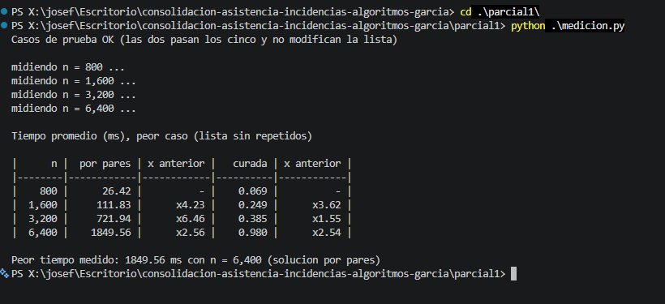

# Jose Fernando Garcia Sanchez

# P1.2 — Curar y medir

## Mi cura

Recorre la lista una vez y guarda en un conjunto los carnets que ya vio, si aparece uno que ya estaba, hay repetido. Es O(n) y no modifca la lista

## Medicion

Peor caso (lista sin repetidos), 1 corrida de calentamiento y 3 corridas medidas, con el promedio. Medido en Python 3.9, ejecutado desde la terminal (captura abajo)

**n = 800**
- Por pares: 26,42 ms
- Curada: 0,069 ms

**n = 1.600**
- Por pares: 111,83 ms (x4,23 respecto de la fila anterior)
- Curada: 0,249 ms (x3,62)

**n = 3.200**
- Por pares: 721,94 ms (x6,46)
- Curada: 0,385 ms (x1,55)

**n = 6.400**
- Por pares: 1849,56 ms (x2,56)
- Curada: 0,980 ms (x2,54)

## Conclusion

- Por pares es O(n²) y se nota: al duplicar n tarda mas o menos x4 (dio x4,23, x6,46 y x2,56). De 800 a 6.400 tardo 70 veces mas, cerca de las 64 esperadas.
- La cura es O(n): al duplicar n deberia tardar x2 y dio entre x1,55 y x3,62.
- Hay ruido, sobre todo en el x6,46 de 3.200 y en la cura, que tarda menos de 1 ms y cualquier variacion se nota mucho.
- El peor tiempo fue 1849,56 ms con n = 6.400 (por pares). Ahii la cura tardo 0,98 ms.