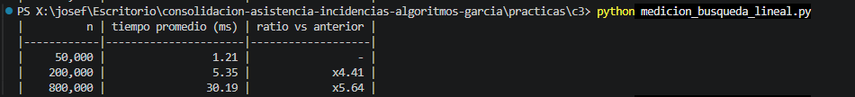

# Tabla de mediciones: búsqueda lineal (Python)

Protocolo: 1 corrida de calentamiento, 5 corridas por tamaño, promedio. Tamaños: n = 50.000, 4n y 16n. Peor caso (el elemento no existe).

|          n | tiempo promedio (ms) | ratio vs anterior |
|------------|----------------------|-------------------|
|     50,000 |                 1.21 |                 - |
|    200,000 |                 5.35 |             x4.41 |
|    800,000 |                30.19 |             x5.64 |

## Observaciones

Repetí el programa 6 veces con n = 50.000 y antes con n = 100.000 (6 corridas). De n a 4n varias corridas dieron cerca de x4 (x4.34 y x4.41), consistente con una búsqueda lineal O(n), aunque otras se alejaron (de x2.14 a x9.27) por el ruido del sistema. De 4n a 16n los ratios fueron de x3.28 a x9.01 con n = 50.000, y de x6.4 a x13.1 con n = 100.000: al bajar n me acerqué más a x4. Mi hipótesis es que con listas muy grandes (millones de elementos) la lista ya no entra en la caché del procesador y el acceso a memoria se vuelve más lento, por eso el tiempo crece más que proporcionalmente. No lo comprobé, es una explicación probable :) .