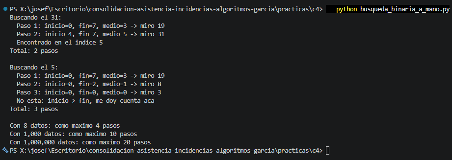

# Búsqueda binaria a mano

`datos = [3, 8, 12, 19, 25, 31, 40, 47]` (8 números, ordenados)

## Respuestas

| Pregunta                   | Pasos | Detalle                                    |
|----------------------------|-------|--------------------------------------------|
| Buscar el 31               |     2 | Medios: 19, 31 (lo encuentra)              |
| Buscar el 5 (no está)      |     3 | Medios: 19, 8, 3 (después inicio > fin)    |
| Máximo con 1.000 datos     |    10 | log₂(1000) ≈ 9,97 → 9 + 1 = 10             |
| Máximo con 1.000.000 datos |    20 | log₂(1.000.000) ≈ 19,93 → 19 + 1 = 20      |

