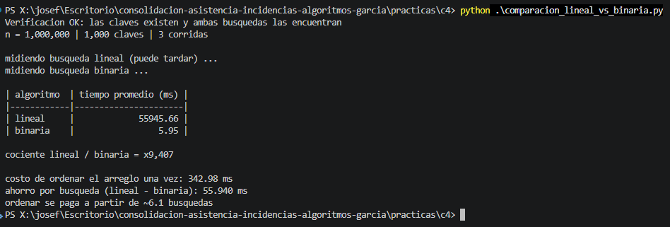

# Comparación medida: búsqueda lineal contra binaria (Python)

Arreglo ordenado de 1.000.000 de enteros y 1.000 claves que sí existen. Protocolo: calentar, 3 corridas, promedio.

## Tiempos promedio (1.000 búsquedas)

| algoritmo  | tiempo promedio (ms) |
|------------|----------------------|
| lineal     |             55945.66 |
| binaria    |                 5.95 |

**Cociente lineal / binaria:** x9,407

## ¿En mi proceso conviene ordenar primero?

- **Sí.** Ordenar cuesta una sola vez (O(n log n)) y después cada búsqueda baja de O(n) a O(log n). En mi proceso se hacen ~1.200 búsquedas por día sobre las mismas listas (empleados, permisos, vacaciones), así que el costo de ordenar se paga enseguida: en la medición, ordenar 1.000.000 de datos (343 ms) se pagó con ~6 búsquedas.
- **Con matices:** con solo 300 empleados el ahorro por búsqueda es chico (de ~150 comparaciones promedio a ~9 como máximo), pero crece con las tablas (~26.400 registros al mes). Si una lista se buscara una sola vez, no valdría la pena ordenarla.