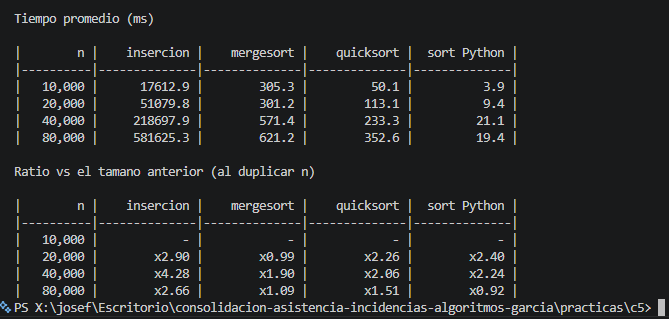

# Torneo de ordenamientos (Python)

Protocolo: calentar, 3 corridas, promedio. Antes de medir se verificó que cada algoritmo deja el arreglo ordenado.

## Tiempos promedio (ms)

|        n |    insercion |    mergesort |    quicksort |  sort Python |
|----------|--------------|--------------|--------------|--------------|
|   10,000 |      17612.9 |        305.3 |         50.1 |          3.9 |
|   20,000 |      51079.8 |        301.2 |        113.1 |          9.4 |
|   40,000 |     218697.9 |        571.4 |        233.3 |         21.1 |
|   80,000 |     581625.3 |        621.2 |        352.6 |         19.4 |

## Ratio al duplicar n

|        n |    insercion |    mergesort |    quicksort |  sort Python |
|----------|--------------|--------------|--------------|--------------|
|   20,000 |        x2.90 |        x0.99 |        x2.26 |        x2.40 |
|   40,000 |        x4.28 |        x1.90 |        x2.06 |        x2.24 |
|   80,000 |        x2.66 |        x1.09 |        x1.51 |        x0.92 |

## Conclusiones

- **Cuadrático contra n log n:** con 80.000 datos la inserción tardó unos 581.625 ms (casi 10 minutos) por corrida, unas 936 veces más que MergeSort (621 ms) y unas 1.650 veces más que QuickSort (353 ms). El sort de Python fue el más rápido (19 ms).
- **Ratios:** la inserción dio x2.90, x4.28 y x2.66 (promedio ~x3.3), cerca del x4 esperado para O(n²), con un solo tramo en x4. MergeSort, QuickSort y el sort de Python estuvieron mayormente entre x1 y x2.4, cerca del "poco más de x2" de O(n log n).
- **Ruido:** algunos ratios salieron fuera de lo esperado (x0.99, x0.92, x1.09). Con tiempos de pocos milisegundos y solo 3 corridas, el ruido del sistema pesa mucho, y por eso no dan exactos.
- **Tiempos altos:** mis tiempos absolutos son grandes. Lo atribuyo a que mi equipo tiene un Intel Core i5 de 7ª generación, a que uso Python 3.9.13 (una versión más lenta que las nuevas) y a que Python es interpretado. Los ratios muestran el patrón igual, porque no dependen de la máquina.
- **Conclusión:** para muchos datos un algoritmo O(n²) no es viable, y conviene un n log n. En la práctica usaría el sort de Python. La inserción solo sirve con pocos datos o casi ordenados.