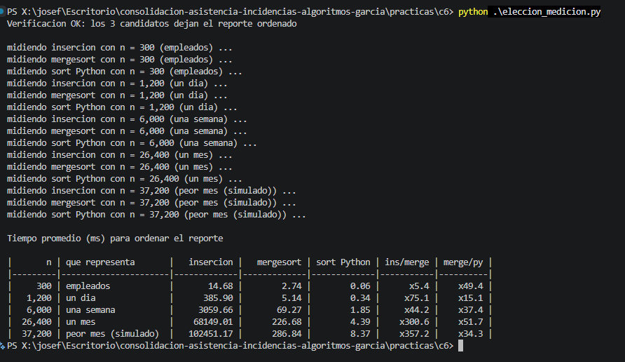

# Elección del algoritmo de ordenamiento para mi caso

Proceso: consolidación diaria de asistencia, permisos y vacaciones (H1).

## 1. Mi proceso y sus datos

Cada día se consolida el reporte del reloj checador del día anterior con las listas de empleados, permisos y vacaciones, para detectar faltas, retardos y omisiones de marcación.

| Dato                                   | Cantidad |
|----------------------------------------|----------|
| Empleados                              |      300 |
| Marcaciones por empleado               |        4 |
| Registros por día                      |   ~1.200 |
| Registros por semana                   |   ~6.000 |
| Registros por mes                      |  ~26.400 |
| Historial de un año (26.400 × 12)      | ~316.800 |
| Peor mes (simulado: 300 × 4 × 31 días) |   37.200 |

Son 4 tablas (asistencia, empleado, vacaciones y permisos) relacionadas por el código del empleado. **El reporte de asistencia sale sin ordenar** del reloj checador (en el H1 no lo detallé; la muestra de 20 filas viene ordenada, pero el reporte real no).

El proceso se repite todos los días del año y los datos se guardan: lo del día 1 queda guardado y el día 2 se suma a lo anterior, así que el archivo va creciendo (~1.200 registros el primer día, ~2.400 el segundo, y así) hasta llegar a ~316.800 al cabo de un año. Por eso hay historial anual.

## 2. La operación que más pesa

**Buscar** el código de cada marcación en las otras tablas (BUSCARV de coincidencia exacta y CONTAR.SI.CONJUNTO): cada búsqueda recorre la lista (O(n)) y se repite por cada marcación, por eso el proceso actual es O(n²).

Para evitarlo, lo que voy a ordenar es el **reporte de asistencia, por código, fecha y hora**. Así las marcaciones de cada empleado quedan juntas y en orden cronológico, que es lo que hace falta para detectar retardos y omisiones, y se puede cruzar con las otras tablas sin buscar una por una.

Como vimos en `c4`, ordenar para buscar con binaria conviene; acá elijo con qué algoritmo ordenar el reporte, que es el que llega desordenado. Las otras tablas se cruzan por código de empleado.

## 3. Tres candidatos

| Candidato         | Cómo ordena                        | O en el peor caso            |
|-------------------|------------------------------------|------------------------------|
| A: Inserción      | inserta cada dato en su lugar      | O(n²) (casi ordenado: ~O(n)) |
| B: MergeSort      | divide en mitades y las mezcla     | O(n log n) siempre           |
| C: Sort de Python | MergeSort + inserción, ya incluido | O(n log n)                   |

Descartados: QuickSort (su peor caso es O(n²) si el pivote es malo) y counting sort (solo sirve con pocos valores distintos, y mi dato combina código, día y hora).

## 4. Mi elección y el porqué

**Elijo C: el sort de Python.**

- Mi reporte llega **sin ordenar**, así que no puedo contar con el caso favorable de la inserción (datos casi ordenados): me toca su peor caso, O(n²).
- B y C garantizan O(n log n) sin importar el orden, y eso protege al proceso en el peor mes.
- Entre B y C, C es el más rápido en mis mediciones y ya viene en el lenguaje, sin código propio que mantener. B es la misma idea escrita a mano.

Evidencia 1, mi torneo de la clase 5 (datos al azar, de 10.000 a 80.000): con 80.000 datos la inserción tardó 581.625 ms y MergeSort 621 ms, o sea, la inserción fue unas 936 veces más lenta. Al duplicar n, la inserción se multiplicó entre x2.7 y x4.3 (cerca del x4 esperado de O(n²)) y MergeSort entre x1.0 y x1.9, con ruido de medición.

Evidencia 2, medida con los tamaños de mi caso (reporte simulado sin ordenar, tiempo promedio en ms):

|      n | qué representa      | inserción | mergesort | sort Python | ins/merge | merge/py |
|--------|---------------------|-----------|-----------|-------------|-----------|----------|
|    300 | empleados           |     14.68 |      2.74 |        0.06 |      x5.4 |    x49.4 |
|  1,200 | un día              |    385.90 |      5.14 |        0.34 |     x75.1 |    x15.1 |
|  6,000 | una semana          |   3059.66 |     69.27 |        1.85 |     x44.2 |    x37.4 |
| 26,400 | un mes              |  68149.01 |    226.68 |        4.39 |    x300.6 |    x51.7 |
| 37,200 | peor mes (simulado) | 102451.17 |    286.84 |        8.37 |    x357.2 |    x34.3 |



- Con el volumen de un día (1.200 registros) la inserción tarda unos 0,4 s, así que no es un problema grave. Lo grave aparece cuando el volumen crece: una semana 3 s, un mes 68 s y el peor mes unos 102 s (casi 2 minutos), mientras MergeSort ordena el peor mes en 287 ms y el sort de Python en 8 ms.
- El cociente inserción / MergeSort crece con n (de x5.4 a x357.2), como se espera de O(n²) contra O(n log n). Hay algo de ruido entre filas (por ejemplo x75.1 en un día y x44.2 en una semana).
- Proyección (no medida): como el archivo crece todos los días, si se ordenara el archivo acumulado de un año (~316.800 registros), la inserción tardaría unas 2,7 horas por ordenamiento (68 s con 26.400 datos, y como es O(n²), 12 veces más datos son unas 144 veces más tiempo), mientras que MergeSort y el sort de Python seguirían en pocos segundos o menos.
- El sort de Python fue entre 15 y 52 veces más rápido que mi MergeSort. Parte de esa diferencia es que está escrito en C y el mío se ejecuta en Python.

## 5. Cómo lo medí

- **Tamaños:** 300, 1.200, 6.000, 26.400 y 37.200 registros.
- **Protocolo:** calentar, 3 corridas, promedio. Antes de medir se verificó que los tres algoritmos dejan el arreglo ordenado.
- **Datos:** reporte simulado sin ordenar. Cada registro es un número que combina código de empleado (9001 a 9300), día y minuto del día, así que ordenarlo equivale a ordenar por código, fecha y hora.
- **Lenguaje:** Python 3.9.
- **Qué comparo:** tiempo promedio de cada candidato y cuántas veces más lento es uno que otro.

## Resumen

```
Datos       : 300 empleados · ~1.200 registros por día (37.200 en el peor mes, simulado) · el reporte sale sin ordenar
Lo que pesa : ordenar el reporte por código, fecha y hora (para dejar de buscar uno por uno)
Candidato A : inserción ......... O(n²)
Candidato B : MergeSort ......... O(n log n)
Candidato C : sort de Python .... O(n log n)
Elección    : C (si tuviera que implementarlo a mano, B)
Evidencia   : peor mes (37.200): inserción 102.451 ms (~1,7 min) · MergeSort 287 ms · sort de Python 8 ms
```