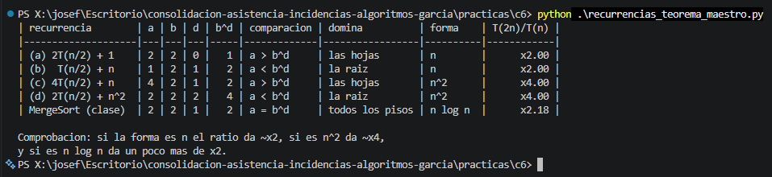

# Recurrencias con el teorema maestro (Python)

T(n) = a·T(n/b) + n^d. Se compara `a` con `b^d`:

- a < b^d → domina la raíz → n^d
- a = b^d → todos los pisos pesan igual → n^d · log n
- a > b^d → dominan las hojas → n^(log_b a)

## Resultados

| recurrencia        | a | b | d | b^d | comparacion | domina          | forma    | T(2n)/T(n) |
|--------------------|---|---|---|-----|-------------|-----------------|----------|------------|
| (a) 2T(n/2) + 1    | 2 | 2 | 0 |   1 | a > b^d     | las hojas       | n        |      x2.00 |
| (b)  T(n/2) + n    | 1 | 2 | 1 |   2 | a < b^d     | la raiz         | n        |      x2.00 |
| (c) 4T(n/2) + n    | 4 | 2 | 1 |   2 | a > b^d     | las hojas       | n^2      |      x4.00 |
| (d) 2T(n/2) + n^2  | 2 | 2 | 2 |   4 | a < b^d     | la raiz         | n^2      |      x4.00 |
| MergeSort (clase)  | 2 | 2 | 1 |   2 | a = b^d     | todos los pisos | n log n  |      x2.18 |

## Comprobación

Evalué cada recurrencia con T(1) = 1 y comparé T(2048) con T(1024). Las de forma n dan x2.00, las de forma n² dan x4.00 y MergeSort (n log n) da un poco más de x2 (x2.18). Coincide con lo que dice la fórmula.